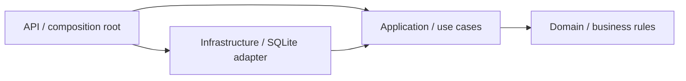

# Architecture decisions

## Keep business rules in the domain

`JobApplication` owns validation, status transitions, and version increments. It does not reference EF Core, HTTP, or dependency-injection libraries. The application layer depends on the domain and a repository port; infrastructure implements that port. The API is the composition root and translates exceptions into HTTP Problem Details.

An arrow means a project dependency, not request flow. Infrastructure can transitively use domain types through Application. Architecture tests check the core dependency boundaries.

## Prefer explicit use cases over extra libraries

For four endpoints, `ApplicationService` is easier to follow than a mediator pipeline. Command/query responsibilities are separate methods, but this demo does not claim a full CQRS system. One repository port exists for the aggregate; there is no generic repository wrapping every EF Core capability.

## Enforce optimistic concurrency twice

Clients send `expectedVersion` when updating status. The use case rejects stale versions before mutation. EF Core also maps `Version` as a concurrency token, so a second writer racing after the first check receives a conflict rather than silently overwriting data. Both the HTTP stale-version path and two competing database contexts are tested.

The version describes a meaningful state change; requesting the existing status is idempotent and does not increment it. A stale version is still rejected even if the requested status happens to equal the current status.

## Use real SQLite in tests

Integration tests use a temporary SQLite database per API factory. The concurrency test uses SQLite in memory with a shared open connection. This tests relational persistence instead of relying on EF Core's non-relational InMemory provider. Unit tests use an application-layer fake repository and a controlled clock.

## Keep events honest

The adapted base entity records domain events; status changes raise an event. The repository clears events after a successful save. No message broker or event handler is installed. These events are a demonstration of aggregate observations, not a durable integration-event system. Production event delivery would require an outbox and a delivery worker.

## Local-demo scope

`EnsureCreated` bootstraps the local database so the sample runs quickly. It is not a migration strategy. Before production, add reviewed migrations, authentication and ownership checks, operational health/readiness checks, rate limits, and appropriate database deployment/backup controls. Count and list are separate reads, so pagination is not a transactionally consistent snapshot during concurrent changes.
